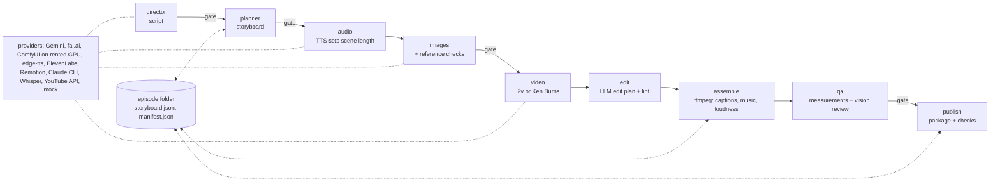

# videoforge

A file-based pipeline for producing short and long-form video. It covers two
paths:

- **AI video from a topic:** script -> storyboard -> voice-over -> frames ->
  animation -> edit -> assembly -> QA -> publish package;
- **clips from your own long-form video:** highlights -> cut -> 9:16 reframe
  -> captions -> edit -> assembly -> QA -> publish package.

Nothing about a niche is hard-coded: characters, styles, voices, niches,
caption styles and editing techniques are swappable YAML resources.

## Why

Generative models make single shots cheap, but a watchable video still needs
continuity (the same character in every frame), rhythm (scene length driven by
the actual voice, not a guess), an edit, captions that don't collide with the
platform UI, loudness targets, and someone to say "stop" before money is spent.
videoforge treats video production as a reproducible build:

- every stage reads artifacts from disk, writes its own and updates
  `storyboard.json`, so an episode can be rebuilt from its JSON files;
- **gates** pause the run before expensive stages for a human review;
- **estimates and budgets** come before paid calls, and every provider has a
  free `mock` implementation, so the whole pipeline can run at $0.

## Architecture



The diagram is the `ai_video` workflow. Three workflows are defined in
`workflows/`: `ai_video`, `clips_from_long` (cut -> translate -> reframe
16:9->9:16 by face -> edit -> assemble -> qa -> publish) and `analyze_channel`
(collect -> stats -> classify -> deep -> visual -> formula -> distill into a
shared playbook).

See **[docs/ARCHITECTURE.md](docs/ARCHITECTURE.md)** for the component diagram
(CLI and control panel, runner, stages, providers), the runtime flow and the
design choices.

```
videoforge/   Python package
  core/       contracts (pydantic), runner, storyboard, ffmpeg helpers, budgets, measurements
  stages/     one module per pipeline stage
  providers/  adapters for external services + mock implementations
  clips/      highlight selection for your own long-form sources
  intel/      channel analysis (analyze_channel workflow)
  api/        FastAPI backend for the control panel
  bench/      reproducible model benchmarks (takes with provenance, verdicts, summary)
  templates/  YAML templates for projects and resources
tests/        pytest suite
ui/           control panel: Vite + React 19 + TypeScript + Tailwind
remotion/     Remotion compositions (programmatic camera moves, showreels)
workflows/    stage order and gates per workflow
resources/    shared resources: caption styles, characters, styles, voices, niches, sfx/music metadata
library/      editing techniques by decision point ("what to apply when")
projects/demo demo project that runs fully on mocks
docs/         architecture, publishing setup, design notes
```

Three levels: a **project** (channel or series: `project.yaml` + `rules.md`)
-> an **episode** (one video: storyboard + one folder per stage) -> **stages**
(as listed in the workflow).

## Key features

- **Voice-driven rhythm:** a scene's duration is the measured length of its
  narration, so paid image/video stages get facts, not guesses.
- **Cast consistency:** characters, locations and props are resources with
  reference portfolios; generated frames are checked against references by a
  vision model before the expensive video stage.
- **Edit plans as data:** an LLM proposes deviations from "hard cut
  everywhere" (transitions, accents, music steps), each with a reason; a linter
  fixes the obvious and blocks the impossible before rendering.
- **Measured output:** loudness (LUFS/dBTP), silence ratio, pauses, freezes,
  black frames, A/V sync and caption-vs-platform-UI zones are measured on the
  final file and reported by the QA stage.
- **Clips from your own long-form videos:** highlight selection from the
  transcript, cutting at pauses, 9:16 reframing with a bundled YuNet face
  detector, karaoke captions with optional translation.
- **Rented GPU support:** ComfyUI on RunPod for image (LoRA) and video (LTX)
  generation, with `gpu up/down/status` commands and cost tracking.
- **Control panel** (`videoforge ui`): projects, episodes, plans, resources,
  technique library, accounts and stats, benchmarks.
- **Channel analysis:** collect public channel metadata, compute statistics,
  classify formats and distil rules into a playbook the planner can use.
- **Cost visibility:** `estimate` before a run, per-stage timings and an HTML
  report after it.

## Tech stack

Python 3.12+ · uv · Typer · pydantic v2 · FastAPI/uvicorn · ffmpeg
(imageio-ffmpeg) · OpenCV (YuNet face detection) · Pillow · yt-dlp ·
google-genai · fal-client · edge-tts · optional Playwright (browser upload) and
faster-whisper (transcription) · React 19 · TypeScript · Vite · Tailwind ·
TanStack Query · Recharts · Remotion · pytest · ruff · mypy · GitHub Actions.

## Quickstart

Requirements: Python 3.12+ and [uv](https://docs.astral.sh/uv/); Node.js only
for the control panel UI and Remotion. ffmpeg is bundled via imageio-ffmpeg.

```bash
uv sync
uv run videoforge doctor               # ffmpeg, keys, SDKs, projects, resources
uv run videoforge run demo/map --mock  # whole pipeline on mocks, no paid calls
uv run videoforge ui --open            # control panel on localhost:8765 (build the UI first)
```

Building the control panel needs Node.js: `cd ui && npm install && npm run build`
(or `.\check.ps1 ui` on Windows).

The demo result is `projects/demo/episodes/map/05_assemble/final.mp4`: coloured
placeholder frames with the prompt text, a slow zoom and silence instead of a
voice, but the whole path from JSON to mp4 is visible.

Real models: configure `.env` (below), then `uv run videoforge run <project>/<episode>`.
The runner stops at gates: review the artifacts,
`uv run videoforge approve <project>/<episode> <stage>`, then `run` again.
Projects, episodes and resources are created with `videoforge project new`,
`videoforge episode new` and `videoforge resource new <kind> <id>`; clip sources
with `videoforge source add <project> <your-video-file>`. See
`uv run videoforge --help`.

## Configuration

All configuration is environment variables, loaded from `.env` (git-ignored):

```bash
cp .env.example .env    # then fill in only the keys you need
```

[`.env.example`](.env.example) documents every variable: provider keys
(Gemini, fal.ai, ElevenLabs, RunPod, YouTube OAuth client), provider selection
per kind (`VF_IMAGE_PROVIDER`, `VF_VIDEO_PROVIDER`, `VF_TTS_PROVIDER`,
`VF_LLM_PROVIDER`, ... each accepts `mock`), model choices and data locations.
`videoforge doctor` reports which keys and SDKs are present without printing
their values. Per-project settings live in `projects/<id>/project.yaml`
(created from `videoforge/templates/project.yaml`, which is commented);
platform accounts in `accounts/<id>.yaml` (see `accounts/example.yaml`).
Publishing setup (YouTube OAuth, browser upload) is described in
[docs/PUBLISHING.md](docs/PUBLISHING.md).

## Testing

```bash
uv run pytest -m "not render"   # fast subset (what CI runs), ~5 minutes
uv run pytest                   # full suite, including video rendering tests
uv run ruff check . && uv run ruff format --check . && uv run mypy videoforge
```

- 899 tests: 827 in the fast subset and 72 marked `render` (they encode video
  with ffmpeg and take seconds each). A guard in `tests/conftest.py` reports
  tests whose marker does not match their measured duration.
- Providers are exercised through mocks and fixtures; the suite needs no API
  keys and no network.
- Two face-detection tests are skipped in this public copy because their
  fixture (a frame with a real person's face) is not included.
- CI ([.github/workflows/ci.yml](.github/workflows/ci.yml)) runs ruff, mypy and
  the fast subset on Ubuntu with Python 3.12.
- On Windows, `.\check.ps1 check` runs everything and `.\check.ps1 quick` runs
  only the tests reached by the current diff through the import graph
  (`tools/affected_tests.py`).

## Project status

A local, single-user tool that the author runs on their own machine (and on a
rented GPU for image/video generation). It is not a hosted service and has no
stability guarantees. It has been used end to end to produce long-form and
short-form videos. This public copy excludes the author's channel projects,
generated media, platform accounts and analytics, research notes and planning
records; `projects/demo` and `accounts/example.yaml` show the formats.

Known limitations: the CLI module (`videoforge/cli.py`) and a few stage modules
are large and would benefit from splitting; most internal comments, CLI output
and the control panel UI are in Russian (top-level modules, the CLI help and the
API are documented in English). Some internal design notes in `docs/` are in
Russian as well. The publish flow for TikTok/Instagram depends on their web UI
and may need selector updates.

Third-party reference material in `docs/reference/` keeps its original MIT
licences; bundled fonts are under the SIL OFL. The project itself is released
under the [MIT licence](LICENSE).

Built with an AI-assisted (agentic) development workflow; architecture, specs and review by the author.
