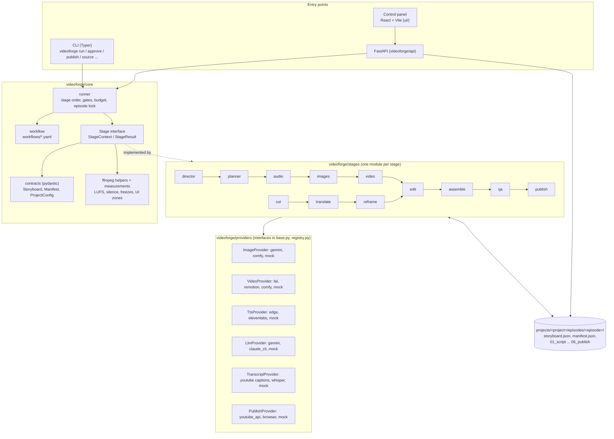

# Architecture

videoforge treats video production as a reproducible, file-based build. Every
stage reads artifacts from an episode folder, writes its own, and updates the
episode's `storyboard.json` and `manifest.json`. There is no database: an
episode can be inspected, edited by hand, and rebuilt from its JSON files.

## Overview

## Concepts

| Concept | Where | Notes |
|---|---|---|
| Project | `projects/<id>/project.yaml`, `rules.md` | a channel or series; settings inherited by episodes |
| Episode | `projects/<id>/episodes/<ep>/` | one video: `storyboard.json` + one folder per stage |
| Workflow | `workflows/*.yaml` | ordered stages; `gate_after: true` pauses for human approval |
| Stage | `videoforge/stages/*.py` | subclass of `core.stage.Stage`, registered in `stages/__init__.py` |
| Provider | `videoforge/providers/` | external service behind an ABC; every provider has a free `mock` |
| Resource | `resources/<kind>/<id>.yaml` | characters, styles, voices, niches, caption styles, music, sfx |
| Technique library | `library/<decision>/<id>.yaml` | editing techniques by decision point ("what to apply when") |

## Runtime flow

1. `videoforge run <project>/<episode>` builds a `ProviderSet` from the
   environment (`providers/registry.py`) and calls `core.runner.run_episode`.
2. The runner takes an OS-level lock on the episode (so the CLI and the control
   panel cannot rebuild the same episode concurrently), selects stages from the
   workflow, and checks the cost estimate against the episode budget.
3. Each stage is idempotent: work that already exists and passed its checks is
   skipped unless `--force`. Stages save after every scene, so an interrupted
   or over-budget run resumes where it stopped.
4. After a stage with `gate_after`, the runner stops and records
   `awaiting_approval` in the manifest. `videoforge approve` releases the gate;
   a stage that changed its output invalidates later approvals.
5. `qa` measures the final file (loudness, silence, freezes, black frames, A/V
   sync, captions vs platform UI zones) and asks a vision model to review
   joins; it reports, it never silently re-renders.
6. Publishing is a separate command with a dry run by default
   (see [PUBLISHING.md](PUBLISHING.md)).

## Workflows

- `ai_video`: topic -> script -> storyboard -> voice-over (sets scene length)
  -> images (checked against reference portfolios) -> image-to-video -> LLM
  edit plan + linter -> ffmpeg assembly -> QA -> publish package.
- `clips_from_long`: your own long-form video -> highlight selection from the
  transcript (`videoforge/clips`) -> cut at pauses -> optional caption
  translation -> face-aware 9:16 reframe -> edit -> assembly -> QA -> publish.
- `analyze_channel`: public channel metadata -> statistics -> LLM
  classification -> deep dives -> formula -> rules distilled into a playbook
  that the planner can use (`videoforge/intel`).

## Design choices

- **Files over services.** Artifacts on disk make every step inspectable and
  diffable, and let a human fix a JSON file instead of re-running a paid stage.
- **Mocks everywhere.** The whole pipeline (and the test suite) runs at $0 with
  `mock` providers; real providers are selected per kind via `VF_*_PROVIDER`.
- **Measure, then decide.** Scene length comes from the measured narration,
  QA thresholds are numbers, and an LLM edit plan is linted deterministically
  before rendering.
- **Humans at the expensive boundaries.** Gates sit before the stages that
  cost money or publish anything.

## Testing

`tests/` contains ~900 pytest tests. Tests marked `render` encode real video
with ffmpeg and are slow; the fast subset (`pytest -m "not render"`) runs in CI
together with ruff and mypy. `tests/conftest.py` flags tests whose `render`
marker does not match their measured duration.
